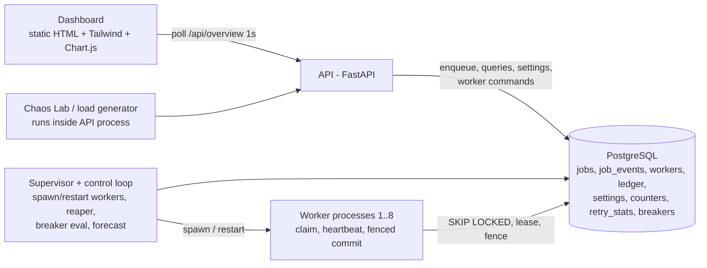

# PRD: Lazarus Prototype (Round 2 → Round 3 selection)

| | |
|---|---|
| Team | Quark |
| Product | Lazarus: reliable asynchronous job runner on Azure |
| Doc type | Prototype PRD (time-boxed build, ~1 day) |
| Build window | Sat 17 Oct (night) to Sun 18 Oct (evening). **Confirm the exact submission time and format.** |
| Build tool | Antigravity (agent-driven). Put this file in the repo root and point every agent at it. |
| Goal | Get selected for Round 3. The full production build comes after selection. |

---

## 1. Summary

A one-command prototype of a job runner with a live dashboard. In under 4 minutes an evaluator can:

1. Click **Run chaos test**: kill and freeze workers under load.
2. Watch five correctness invariants stay green.
3. Flip **Fencing OFF** and watch the same test produce duplicate charges.

**Win condition:** the judges *see* the three claims from our deck (no lost jobs, no duplicate effects, failure contained) proven live, rather than described.

### Goals (in priority order)
1. **Real core.** Real Postgres, leases, fencing and reaper. This is not a mock. The proof only has value if it is real.
2. **Presentable dashboard** that matches the mockup in our submitted deck (sidebar, KPI cards, worker table with Kill button, invariants panel).
3. **All six novelty features visibly demonstrable**, even in a minimal form.
4. **Zero-friction run:** `docker compose up` or `python run_all.py`, plus a seeded demo and a recorded video as a safety net.

### Non-goals (explicitly deferred to Round 3)
- KEDA and multi-replica Azure topology, advisory-lock leader election, per-tenant fair claiming.
- React/Vite frontend, SSE (we poll), authentication, multi-queue routing, cron schedules.
- Service Bus adapter, Blob claim-check, Key Vault.

---

## 2. Prototype vs. submitted deck (be honest, and say it first)

| Deck component | Prototype | Round 3 |
|---|---|---|
| API (FastAPI) | **Real** | same |
| PostgreSQL state | **Real.** Docker Postgres by default; Azure PG Flexible Server if `DATABASE_URL` points to it | Azure PG |
| Worker pool (2-8 replicas) | **Real.** 2-8 OS processes run by a supervisor in one host/container | Container Apps replicas |
| Reaper / Scheduler | **Real**, single control loop (no leader election) | advisory-lock leader |
| Fencing, leases, retries, DLQ, replay | **Real** | same |
| Circuit breaker, poison quarantine, retry classifier | **Real** (stats-based, stdlib only) | + tuning, scikit-learn if justified |
| KEDA autoscaling | **Simulated.** Forecast recommends worker count; "Apply" button (or auto mode) scales the supervisor | real KEDA scale rule on the same queue-depth metric |
| Observability | In-app events/logs + counters. App Insights via OTel is optional (P2) | full OTel to App Insights |
| Dashboard | Static HTML + Tailwind CDN + Chart.js (no build step) | React + Vite |
| Per-tenant limits | In-memory token bucket at the API (P2). **No fair claiming yet** | fair claim in SQL |

**Line to use in the demo:** "The reliability core is production-shaped and real. Scaling and cloud topology are simulated in this prototype and become real in Round 3."

---

## 3. Evaluator journey (what the build must support)

| t | Action | What they see |
|---|---|---|
| 0:00 | Open dashboard | Idle system, 3 healthy workers, invariants green |
| 0:20 | Chaos Lab → **Run chaos test** (300 jobs, kills every 8s, random freezes) | Throughput chart moves, KPI cards change |
| 1:00 | Watch workers table | A worker flips to DEAD, supervisor restarts it, orphaned jobs are reclaimed |
| 1:30 | Invariants panel | All green; "stale writes rejected: n" is non-zero (zombies caught) |
| 2:00 | Report card | PASS: acknowledged = accounted, duplicate effects = 0 |
| 2:15 | Toggle **Fencing OFF**, rerun | **FAIL.** Duplicate ledger rows appear, with red invariants |
| 2:45 | Insights tab | Learned retry verdict, breaker open during an outage, forecast + recommended workers |
| 3:15 | DLQ tab → **Replay** | Dead jobs requeue and complete |

---

## 4. Functional requirements

Priorities: **P0** must work by Sun 14:00. **P1** by Sun 17:30. **P2** only if ahead of schedule.

### 4.1 Core queue

| ID | Requirement | Pri | Acceptance criteria |
|---|---|---|---|
| C1 | Idempotent enqueue `POST /api/jobs` | P0 | Same `(tenant_id, idempotency_key)` twice returns the same job id (201 then 200). `acked` counter increments once |
| C2 | Claim with `FOR UPDATE SKIP LOCKED` + lease + `fence++` | P0 | pytest: 200 concurrent claimers over 1,000 jobs, zero jobs claimed twice |
| C3 | Batch heartbeat; handler cancelled if lease lost | P0 | Heartbeat returns `(id, fence)` pairs; any in-flight pair missing means cancel that task |
| C4 | Fenced complete; ledger write in the same transaction | P0 | Stale fence matches 0 rows, whole tx rolls back, `stale_writes_rejected++`, event logged |
| C5 | Retry with capped exponential backoff + full jitter; DLQ after `max_attempts` | P0 | Delay always in `[0, min(cap, base·2^attempt)]` (unit test) |
| C6 | Reaper reclaims expired leases | P0 | Kill a worker mid-job; job finishes on another worker within `LEASE + 3s` |
| C7 | DLQ list, replay one, replay all | P0 | Replay resets `attempts=0, crash_count=0, status=queued` |
| C8 | Delayed jobs (`delay_seconds`) | P1 | Job not claimable before `run_at` |
| C9 | SIGTERM graceful drain | P1 | Stop claiming, finish in-flight (max 10s), release leftovers to `queued` |

### 4.2 Workers, supervisor, chaos primitives

| ID | Requirement | Pri | Acceptance criteria |
|---|---|---|---|
| W1 | Supervisor spawns and restarts N worker processes; `desired_workers` read from `settings` (clamp 1-8, default 3) | P0 | Killed worker is replaced within 4s with a new `worker_id` |
| W2 | Worker `kill` command: `os._exit(137)` with no cleanup | P0 | Lease is **not** released; recovery depends on the reaper |
| W3 | Worker `freeze` command: blocking `time.sleep(LEASE*1.8)`, no heartbeats, then resumes and tries to commit | P0 | Late commit is rejected (fencing ON) |
| W4 | Handlers (see §8) | P0/P1 | 3 handlers P0, rest P1 |
| W5 | Worker async concurrency (default 4 jobs per worker) | P0 | `in_flight` shown per worker |

### 4.3 Dashboard

| ID | Screen | Pri |
|---|---|---|
| D1 | **Overview:** KPI cards, throughput chart, invariants panel, breaker chips, counters, events feed | P0 |
| D2 | **Workers:** table with Kill / Freeze buttons, scale stepper | P0 |
| D3 | **Jobs:** filterable table, job detail drawer with event timeline, enqueue form | P0 |
| D4 | **DLQ:** table, Replay, Replay all | P0 |
| D5 | **Chaos Lab:** run config, Run button, fencing toggle, outage toggle, poison injector, report card | P1 |
| D6 | **Insights:** retry intelligence, breakers, forecast + recommended workers | P1 |

### 4.4 Novelty features (from the deck's six cards)

| ID | Novelty | Pri | Minimum demonstrable version |
|---|---|---|---|
| N1 | **Proof, not promises** | P0 | Live invariants panel (5 checks, refreshed every 1s) + chaos report card with PASS/FAIL |
| N2 | **Zombie workers caught** | P0 | Freeze button + `stale_writes_rejected` counter + **Fencing ON/OFF toggle** |
| N3 | **Learns what to retry** | P1 | `legacy_sync` bad records are learned as permanent and dead-lettered early; Insights table shows `p(success on retry)` and "retries avoided" |
| N4 | **Stops retry storms** | P1 | "Simulate outage" toggle on `flaky_webhook` → breaker OPEN chip with countdown, held-back jobs gauge, attempts/s drops |
| N5 | **Sees trouble coming** | P1/P2 | Forecast chart + recommended workers + Apply button (P1). Slow-job anomaly badge (P2) |
| N6 | **Catches silent crashes** | P0/P1 | `poison_pill` kills workers silently; after 3 lease expiries the job is quarantined with reason; fleet stabilizes |

### 4.5 Platform

| ID | Requirement | Pri |
|---|---|---|
| X1 | README with one-command run, screenshots, architecture diagram, "prototype vs deck" table | P0 |
| X2 | pytest suite: concurrent claim, fencing, reaper, idempotency, backoff bounds | P0 |
| X3 | Per-tenant token-bucket rate limit (429 + `Retry-After`) and counter | P2 |
| X4 | Optional OpenTelemetry to Application Insights when `APPLICATIONINSIGHTS_CONNECTION_STRING` is set | P2 |
| X5 | Dockerfile (single container: API + supervisor + workers) and Azure Container Apps deploy | P2 |

---

## 5. Architecture and stack



| Layer | Choice | Rationale |
|---|---|---|
| Language | Python 3.12 | Fastest for AI-assisted build; same language for API, workers, ML |
| API | FastAPI + Pydantic v2 + uvicorn | Quick; auto docs at `/docs` help during the demo |
| DB | PostgreSQL 16 | `SKIP LOCKED` is required |
| Driver | psycopg 3 async + pool, **raw SQL, no ORM** | The queue SQL must be exact |
| Workers | `asyncio` per process, supervised by `asyncio.create_subprocess_exec` | Real process death for kill/freeze |
| Frontend | One `index.html` + Tailwind CDN + Chart.js CDN + vanilla JS (or Alpine.js CDN), served by FastAPI `StaticFiles` | **No Node, no build step** |
| ML | Pure Python `math` (Beta posterior, Holt/EWMA) | No heavy dependencies, explainable |
| Tests | pytest + pytest-asyncio against the compose Postgres | |
| Packaging | `docker-compose.yml` (postgres + app) and `run_all.py` | App runs without Docker if Postgres is up |
| Azure (P2) | Azure Database for PostgreSQL via `DATABASE_URL`; single container to Azure Container Apps; OTel to App Insights | Verify CLI flags, SKUs and quota in the portal |

Processes (`run_all.py` starts the first two):
- `api`: uvicorn, REST + static dashboard + chaos orchestration task.
- `supervisor`: worker lifecycle + control loop (reaper every 2s, forecast every 2s).
- `worker` ×N: spawned by the supervisor (`python -m app.worker`).

### Repo layout
```
lazarus/
  PRD.md  README.md  docker-compose.yml  Dockerfile  run_all.py  requirements.txt
  schema.sql
  app/
    config.py  db.py
    queue.py          # enqueue, claim, heartbeat, complete, fail, reap, replay (SQL contract)
    retry.py          # backoff, fingerprint, classify, learn
    breaker.py        # evaluate + open
    forecast.py       # Holt + recommendation
    invariants.py     # the 5 checks
    api/main.py  api/routes.py  api/chaos.py
    worker/main.py  worker/handlers.py
    supervisor.py
  static/index.html  static/app.js
  tests/            # test_claim.py test_fencing.py test_reaper.py test_idempotency.py test_backoff.py
```

---

## 6. Data model and SQL contract

**Rules for agents:** do not change these semantics, no ORM, every job state write after claim is fenced (except in explicit unsafe mode), all lease time uses the database `now()`.

```sql
CREATE EXTENSION IF NOT EXISTS pgcrypto;

CREATE TABLE jobs (
  id uuid PRIMARY KEY DEFAULT gen_random_uuid(),
  tenant_id text NOT NULL,
  type text NOT NULL,
  payload jsonb NOT NULL DEFAULT '{}',
  idempotency_key text,
  priority int NOT NULL DEFAULT 0,
  status text NOT NULL DEFAULT 'queued'
    CHECK (status IN ('queued','running','succeeded','dead')),
  run_at timestamptz NOT NULL DEFAULT now(),
  attempts int NOT NULL DEFAULT 0,
  max_attempts int NOT NULL DEFAULT 5,
  lease_owner text,
  lease_expires_at timestamptz,
  fence bigint NOT NULL DEFAULT 0,
  crash_count int NOT NULL DEFAULT 0,
  quarantined boolean NOT NULL DEFAULT false,
  last_error text,
  error_class text,                 -- transient | permanent | learned_permanent | lease_expired
  last_fp text,                     -- error fingerprint of the last failure
  result jsonb,
  started_at timestamptz,
  duration_ms int,
  created_at timestamptz NOT NULL DEFAULT now(),
  finished_at timestamptz,
  UNIQUE (tenant_id, idempotency_key)
);
CREATE INDEX jobs_claim_idx ON jobs (priority DESC, run_at) WHERE status = 'queued';
CREATE INDEX jobs_lease_idx ON jobs (lease_expires_at) WHERE status = 'running';
CREATE INDEX jobs_status_idx ON jobs (status);

CREATE TABLE job_events (
  id bigserial PRIMARY KEY, job_id uuid, job_type text,
  event text NOT NULL,   -- enqueued|claimed|succeeded|failed|lease_expired|dead|quarantined|stale_write_rejected|replayed|retry_avoided
  worker text, attempt int, detail jsonb, at timestamptz NOT NULL DEFAULT now()
);
CREATE INDEX job_events_at_idx ON job_events (at);
CREATE INDEX job_events_job_idx ON job_events (job_id);

CREATE TABLE workers (
  worker_id text PRIMARY KEY, name text, pid int,
  started_at timestamptz DEFAULT now(), last_seen timestamptz DEFAULT now(),
  in_flight int DEFAULT 0, command text,            -- NULL | 'kill' | 'freeze'
  status text DEFAULT 'healthy'                     -- healthy | frozen | dead
);

-- Deliberately NO unique constraint on job_id: this table is the proof of exactly-once.
CREATE TABLE ledger (
  id bigserial PRIMARY KEY, job_id uuid NOT NULL, tenant_id text,
  account text, amount numeric, created_at timestamptz DEFAULT now()
);

CREATE TABLE settings (key text PRIMARY KEY, value text NOT NULL);
-- keys: desired_workers=3, fencing_enabled=true, outage_flaky_webhook=false, autoscale=manual

CREATE TABLE counters (name text PRIMARY KEY, value bigint NOT NULL DEFAULT 0);
-- names: acked, stale_writes_rejected, lease_expired, quarantined, retries_avoided, rate_limited

CREATE TABLE retry_stats (
  job_type text, fp text, successes int NOT NULL DEFAULT 0, failures int NOT NULL DEFAULT 0,
  PRIMARY KEY (job_type, fp)
);

CREATE TABLE breakers (
  job_type text PRIMARY KEY, open_until timestamptz, window_start timestamptz DEFAULT now(),
  opened_count int NOT NULL DEFAULT 0
);
```

```sql
-- ENQUEUE (idempotent). 0 rows returned => SELECT existing, respond 200. Increment counters.acked only on insert.
INSERT INTO jobs (tenant_id, type, payload, idempotency_key, priority, run_at, max_attempts)
VALUES ($1,$2,$3,$4,$5,now() + make_interval(secs => $6::float8),$7)
ON CONFLICT (tenant_id, idempotency_key) DO NOTHING
RETURNING *;

-- CLAIM: $1 worker_id, $2 batch size, $3 lease seconds. Skips job types whose breaker is open.
WITH picked AS (
  SELECT id FROM jobs
  WHERE status = 'queued' AND run_at <= now()
    AND type NOT IN (SELECT job_type FROM breakers WHERE open_until > now())
  ORDER BY priority DESC, run_at
  FOR UPDATE SKIP LOCKED
  LIMIT $2
)
UPDATE jobs j
SET status='running', lease_owner=$1,
    lease_expires_at = now() + make_interval(secs => $3::float8),
    attempts = attempts + 1, fence = fence + 1, started_at = now()
FROM picked WHERE j.id = picked.id
RETURNING j.*;

-- BATCH HEARTBEAT: $1 worker_id, $2 lease seconds.
-- Compare returned (id, fence) with the worker's in-flight set; any missing/changed => lease lost, cancel that handler.
UPDATE jobs SET lease_expires_at = now() + make_interval(secs => $2::float8)
WHERE lease_owner = $1 AND status = 'running'
RETURNING id, fence;

-- COMPLETE, SAFE MODE (fencing_enabled = true). One transaction:
--   1) INSERT INTO ledger (...)            -- the handler's effect
--   2) the UPDATE below; if rowcount = 0 => ROLLBACK (discards the ledger insert),
--      then in a new tx: counters.stale_writes_rejected++, event 'stale_write_rejected'
UPDATE jobs SET status='succeeded', result=$3, finished_at=now(), duration_ms=$4,
                lease_owner=NULL, lease_expires_at=NULL
WHERE id=$1 AND fence=$2 AND status='running';
-- COMPLETE, UNSAFE MODE (fencing_enabled = false; demo only): same, but "WHERE id = $1" with no fence/status check.
-- In unsafe mode the worker also ignores lease-lost signals from heartbeat.

-- FAIL: $3 error text, $4 is_permanent bool, $5 backoff seconds, $6 fingerprint, $7 error_class
UPDATE jobs SET
  status = CASE WHEN $4 OR attempts >= max_attempts THEN 'dead' ELSE 'queued' END,
  run_at = now() + make_interval(secs => $5::float8),
  last_error=$3, last_fp=$6, error_class=$7,
  finished_at = CASE WHEN $4 OR attempts >= max_attempts THEN now() END,
  lease_owner=NULL, lease_expires_at=NULL
WHERE id=$1 AND fence=$2 AND status='running';

-- REAPER (control loop, every 2s). $1 backoff cap, $2 backoff base, $3 poison threshold (default 3)
UPDATE jobs SET
  crash_count = crash_count + 1,
  quarantined = (crash_count + 1 >= $3::int),
  status = CASE WHEN crash_count + 1 >= $3::int OR attempts >= max_attempts THEN 'dead' ELSE 'queued' END,
  run_at = now() + make_interval(secs => random() * LEAST($1::float8, $2::float8 * power(2, attempts))),
  last_error = CASE WHEN crash_count + 1 >= $3::int
                    THEN 'quarantined: worker died silently ' || (crash_count + 1)::text || 'x'
                    ELSE 'lease expired (worker lost)' END,
  error_class = 'lease_expired',
  finished_at = CASE WHEN crash_count + 1 >= $3::int OR attempts >= max_attempts THEN now() END,
  lease_owner=NULL, lease_expires_at=NULL
WHERE id IN (
  SELECT id FROM jobs WHERE status='running' AND lease_expires_at < now()
  FOR UPDATE SKIP LOCKED LIMIT 100
)
RETURNING id, status, crash_count, quarantined;

-- REPLAY
UPDATE jobs SET status='queued', attempts=0, crash_count=0, quarantined=false,
                run_at=now(), finished_at=NULL, lease_owner=NULL, lease_expires_at=NULL
WHERE id=$1 AND status='dead';
```

**Heartbeat + command channel (worker, every 2s):**
`UPDATE workers SET last_seen=now(), in_flight=$2, status=$3 WHERE worker_id=$1 RETURNING command;`
`kill` → `os._exit(137)`. `freeze` → clear the command, then `time.sleep(LEASE*1.8)` (blocks the whole event loop).

### Invariants (evaluated every second for the dashboard)

| ID | Name | Query / rule | Healthy |
|---|---|---|---|
| I1 | No acknowledged job lost | `count(jobs) = counters.acked` and `count(*) = succeeded+dead+queued+running` | equal |
| I2 | No duplicate effects | `SELECT count(*) FROM (SELECT job_id FROM ledger GROUP BY job_id HAVING count(*) > 1) t` | 0 |
| I3 | Exactly-once for succeeded credits | succeeded `ledger_credit` jobs whose ledger row count ≠ 1 | 0 |
| I4 | No ghost effects | ledger rows whose job is not `succeeded` | 0 |
| I5 | No stuck leases | `running` jobs with `lease_expires_at < now() - 2*LEASE` | 0 |

Also display (informational): `stale_writes_rejected`, `lease_expired`, `quarantined`, `retries_avoided`.

---

## 7. API

All JSON, prefix `/api`. The dashboard polls `GET /overview` every 1s.

| Method + path | Purpose |
|---|---|
| `POST /jobs` | Enqueue `{tenant_id, type, payload, idempotency_key?, priority?, delay_seconds?}` → 201 new / 200 existing / 429 rate limited |
| `GET /jobs?status=&type=&tenant=&limit=` | List (newest first) |
| `GET /jobs/{id}` | Detail + event timeline |
| `POST /jobs/{id}/replay`, `POST /dlq/replay-all` | Replay dead jobs |
| `GET /overview` | KPIs, throughput series (60s), invariants, counters, breakers, workers, recent events, settings |
| `GET /workers` | Worker rows |
| `POST /workers/{worker_id}/kill`, `/freeze` | Set `workers.command` |
| `POST /workers/scale` `{desired}` | Set `desired_workers` (1-8) |
| `POST /settings` `{fencing_enabled?, outage_flaky_webhook?, autoscale?}` | Toggles |
| `GET /insights` | Retry stats, breakers, forecast + recommendation, slow-job flags |
| `POST /chaos/run` `{jobs, tenants, mix?, jobs_per_sec, kill_every_s, freeze, noisy_tenant?}` | Start a chaos run (async task in API process) |
| `GET /chaos/run/latest` | Progress + report card |
| `POST /chaos/poison` `{count}` | Inject poison_pill jobs |
| `POST /chaos/reset` | Truncate jobs/events/ledger/counters (demo reset) |
| `GET /healthz` | Liveness |

**KPI definitions (Overview):** Total = `count(jobs)`. Processing = `running`. Retrying = `queued AND attempts > 0`. DLQ = `dead`. Show "% of total" under each.

---

## 8. Workers, handlers and tunables

| Env var | Default | Notes |
|---|---|---|
| `LEASE_SECONDS` | 6 | Short on purpose for a snappy demo |
| `HEARTBEAT_SECONDS` | 2 | |
| `WORKER_CONCURRENCY` | 4 | Jobs in flight per worker |
| `POLL_INTERVAL` | 0.3 | Sleep when no jobs claimed |
| `MAX_ATTEMPTS` | 5 | |
| `BACKOFF_BASE` / `BACKOFF_CAP` | 1.5 / 20 | `delay = uniform(0, min(cap, base·2^attempt))` |
| `POISON_THRESHOLD` | 3 | Lease expiries before quarantine |
| `REAPER_INTERVAL` | 2 | |
| `DATABASE_URL` | local compose | Azure PG supported |

| Handler (`type`) | Behaviour | Demonstrates |
|---|---|---|
| `ledger_credit` `{account, amount}` | Sleeps 1-4s (long enough to be hit by kills), then writes a `ledger` row **inside the completing transaction** | N1, N2 (the money invariant) |
| `flaky_webhook` | 0.3-1s; 15% random `HTTP 503`. If `outage_flaky_webhook=true`: 100% `HTTP 503` | Transient retries, N4 breaker |
| `validate_order` | 30% of payloads raise `ValidationError:missing_field` | Permanent → straight to DLQ |
| `legacy_sync` | Payload `bad:true` (15% of jobs) → always `ConnectionResetError` (looks transient). Others succeed | N3 learned-permanent |
| `report_export` | 1s normally; 5% take 10x longer | N5 slow-job anomaly (P2) |
| `poison_pill` | `os._exit(1)` inside the handler: silent worker death, no failure report | N6 quarantine |

Handler contract: `async def handler(ctx) -> dict`. `ctx.effect(account, amount)` buffers a ledger row that `complete()` writes atomically with the fenced update.

Graceful shutdown (C9): on SIGTERM, stop claiming, wait up to 10s for in-flight jobs, then release the rest with `UPDATE ... SET status='queued', lease_owner=NULL ... WHERE id=$1 AND fence=$2`.

---

## 9. Novelty specs (algorithms)

### N1 Proof, not promises
- Invariants panel (I1-I5) from §6, each with a green check or red cross and its current value.
- **Chaos run** (`/chaos/run`), orchestrated in the API process:
  1. Enqueue `jobs` at `jobs_per_sec` across `tenants` (mix default: 50% ledger_credit, 15% flaky_webhook, 10% validate_order, 10% legacy_sync, 15% report_export). Count 2xx as acknowledged.
  2. Every `kill_every_s` seconds, kill a random healthy worker. If `freeze` is on, also freeze a random worker every ~12s.
  3. Wait until `queued = running = 0` (timeout 120s).
  4. Report card: acknowledged, succeeded, dead (with reason breakdown), lease expiries, stale writes rejected, duplicate effects, retries avoided, I1-I5, **verdict PASS iff all invariants hold and the queue drained**.

### N2 Zombie workers caught
- Freeze = `time.sleep(LEASE*1.8)`. The lease expires, the reaper requeues, another worker runs the job, then the zombie wakes and tries to commit.
- Fencing ON: its `UPDATE` matches 0 rows, so its ledger insert is rolled back and `stale_writes_rejected++`.
- **Fencing OFF (unsafe mode):** the zombie commits, I2/I3 turn red. Make the toggle a prominent switch with a "this is the bug fencing prevents" caption.

### N3 Learns what to retry
- Fingerprint: `fp = f"{ExceptionClass}:{http_status_or_code}"`.
- Rule prior: `ValidationError`, or HTTP 4xx except 408/429 → permanent. Everything else → transient.
- Observations per `(job_type, fp)`:
  - A retry of a job that previously failed with `fp` succeeds → `successes++`.
  - It fails again with the same `fp` → `failures++`.
- Posterior `p = (1 + successes) / (2 + successes + failures)`, `n = successes + failures`.
- **Learned-permanent** when `n ≥ 8` and `p < 0.15`. The job goes straight to `dead` with `error_class='learned_permanent'`, and `retries_avoided += (max_attempts - attempts)`.
- **Guard:** learning is suspended for a type while its breaker is open or cooling. Systemic failure (outage) is not job-specific failure.
- Insights table columns: job type, fingerprint, retries observed, `p(success on retry)`, verdict (`retry` / `learned-permanent`), retries avoided.
- Fallback if cut: rule-based classification only; the table becomes read-only stats.

### N4 Stops retry storms (circuit breaker per job type)
- Evaluated after every failure and by the control loop.
- Window: attempts finishing after `breakers.window_start` and within the last 20s. **Open** if samples ≥ 6 and failure rate ≥ 70%.
- On open: `open_until = now() + 15s`, `window_start = open_until`, `opened_count++`. Claims skip that type (see claim SQL).
- After the cooldown, jobs flow again as the probe. If failures resume, the breaker re-opens after 6 new samples.
- Dashboard: chip per type (CLOSED / OPEN with countdown), "held back" gauge = queued, ready jobs of open types, and a chart of attempts/s for `flaky_webhook`.
- Note: the 15% bad-record share in `legacy_sync` is sized to stay below the 70% threshold. Do not raise it.

### N5 Sees trouble coming
- Arrival rate λ: count `enqueued` events in 5s buckets over the last 120s. Holt's linear smoothing (α=0.4, β=0.2), one-step-ahead forecast `λ̂`.
- Service time `s` = mean `duration_ms` of the last 100 successes. `c = WORKER_CONCURRENCY`. `backlog` = ready queued jobs.
- `recommended = clamp(ceil( (λ̂·s + backlog·s/30) / c × 1.2 ), 1, 8)`. 30s is the target drain time.
- UI: forecast line vs actual, a "Recommended: N workers (current M)" card, **Apply** button. Optional `autoscale=auto` mode: the control loop applies the recommendation with a 10s cooldown.
- Slow-job anomaly (P2): for running jobs, flag `SLOW` if elapsed > mean + 3σ of that type's last 200 durations (needs n ≥ 20).

### N6 Catches silent crashes
- A job that kills its worker never reports a failure, so the signal is lease expiry. The reaper increments `crash_count`; at `POISON_THRESHOLD` the job becomes `dead`, `quarantined=true`, with a clear reason.
- Demo button: "Inject 1 poison job". Show the workers table flipping DEAD → restarted up to 3 times, then calm, plus the quarantined counter and a quarantined badge in the DLQ.

---

## 10. UI spec

**Look:** dark navy theme matching the deck's mockup. Header shows the Quark logo text and "Lazarus: failure is the normal case, and we prove it".
Tokens: bg `#0b1220`, card `#111a2e`, border `#1f2a44`, text `#e5e7eb`, muted `#94a3b8`, blue `#3b82f6`, green `#22c55e`, red `#ef4444`, amber `#f59e0b`. Font: Inter (Google Fonts) or system-ui.

**Shell:** left sidebar (Overview, Workers, Jobs, DLQ, Chaos Lab, Insights). Top bar shows a **Fencing: ON/OFF** badge (red when OFF), current worker count, and a Reset demo button. Tab switching is client-side with no routing.

**Overview wireframe**
```
┌────────┬────────────────────────────────────────────────────────────────┐
│Lazarus │ [Total 512] [Processing 284] [Retrying 12] [DLQ 8]   Fencing ON│
│        │ ┌ Throughput (ok/s, fail/s, 60s) ────────┐ ┌ Invariants ────┐ │
│Overview│ │                                        │ │ ✓ I1 no loss   │ │
│Workers │ │                                        │ │ ✓ I2 no dup    │ │
│Jobs    │ └────────────────────────────────────────┘ │ ✓ I3 exactly 1 │ │
│DLQ     │ ┌ Breakers ──────┐ ┌ Counters ───────────┐ │ ✓ I4 no ghost  │ │
│Chaos   │ │ flaky_webhook ●│ │ stale rejected  7   │ │ ✓ I5 no stuck  │ │
│Insights│ └────────────────┘ │ lease expired  12   │ └────────────────┘ │
│        │ ┌ Events feed (latest 15) ───────────────┐ quarantined 1      │
└────────┴────────────────────────────────────────────────────────────────┘
```

**Behaviour rules**
- Every number updates from the 1s poll. Use no animation libraries. Flash a card border on change.
- Invariant red state is loud: red panel border + banner "INVARIANT VIOLATED".
- Worker status colors: healthy green, frozen amber, dead red. Dead rows remain visible for 10s.
- Destructive buttons (Kill, Freeze) have no confirm dialog, because they are the demo.
- Chaos Lab report card is a modal-less card with a big PASS/FAIL badge and the numbers table.
- Empty states (no jobs yet) show a "Run a demo load" button instead of blank tables.
- Responsive down to a laptop width of 1280px; mobile is not required.

---

## 11. Build plan (Sat night → Sun evening)

Assumes a start around Sat 21:45. Shift everything if the deadline is earlier. **Feature freeze is T-3h before submission.**

| When | Phase | Output |
|---|---|---|
| Sat 21:45-22:30 | **P-0 Scaffold** | Repo, PRD + SQL in the repo, docker-compose Postgres, `schema.sql`, config/db modules, health endpoint |
| Sat 22:30-00:30 | **P-1 Core** | `queue.py` (all SQL), worker loop + 3 handlers, reaper, tests X2 green |
| Sun 08:30-10:30 | **P-2 Runtime** | Supervisor, kill/freeze, remaining handlers, DLQ/replay, API routes |
| Sun 10:30-13:30 | **P-3 Dashboard v1** | Overview, Workers, Jobs, DLQ + invariants panel |
| 13:30-14:00 | Break + **Checkpoint A** | P0 must be complete (see cut-lines) |
| Sun 14:00-16:30 | **P-4 Chaos + novelty** | Chaos Lab + report card, fencing toggle, poison quarantine, breaker + outage toggle |
| Sun 16:30-18:00 | **P-5 Insights** | Learned retries, forecast + Apply |
| Sun 18:00 | **FEATURE FREEZE** | Only bug fixes after this |
| Sun 18:00-19:30 | **P-6 Polish** | README, screenshots, demo reset + seed, rehearsal ×3 |
| Sun 19:30-20:15 | **Record video** | 3-4 min backup demo (also submit it if allowed) |
| Sun 20:15-21:00 | **Submit** | Repo + video + diagram + notes |

### Cut-lines (decide at the checkpoints, not by feel)
- **Checkpoint A (Sun 14:00):** if C1-C7, W1-W3 and D1-D4 are not working end to end, drop N3 (keep rule-based), N5 and X3-X5 immediately.
- **Checkpoint B (Sun 16:30):** if the chaos report card is not PASS/FAIL-correct, stop all novelty work and fix it. N1 + N2 + N6 are the story.
- **Cut order (first to last):** Azure deploy/App Insights, slow-job anomaly, rate limiting, forecast auto-mode, forecast chart, N3 learning (keep rules), N4 breaker. **Never cut:** N1, N2, N6, DLQ replay.

### Antigravity prompt sequence
Give every agent: `PRD.md` + "Follow §6 SQL exactly. No ORM. No new dependencies without telling me. Run the tests before reporting done."

1. **Scaffold:** "Create the repo layout from §5, docker-compose with Postgres 16, `schema.sql` from §6, config via env vars from §8, async psycopg pool, `/healthz`, and `run_all.py` that starts the API and the supervisor."
2. **Core:** "Implement `app/queue.py` with enqueue, claim, heartbeat, complete (safe and unsafe), fail, reap, replay exactly per §6. Write pytest tests: 200 concurrent claimers with no double claim, fenced complete rejects stale writes and rolls back the ledger row, reaper reclaims expired leases, idempotent enqueue, backoff bounds."
3. **Workers:** "Implement the worker (claim loop, concurrency semaphore, one batch heartbeat task with lease-lost cancellation, command channel kill/freeze, SIGTERM drain) and handlers `ledger_credit`, `flaky_webhook`, `validate_order` per §8. Implement the supervisor (spawn/restart per `desired_workers`, mark dead workers) and the control loop (reaper every 2s)."
4. **API:** "Implement the routes in §7 including `/overview` with KPIs, 60s throughput series, invariants I1-I5, counters, workers, and recent events."
5. **Dashboard:** "Build `static/index.html` + `app.js` per §10: dark theme, sidebar, Overview/Workers/Jobs/DLQ tabs, 1s polling, Chart.js throughput chart, invariants panel, Kill/Freeze buttons, job drawer with event timeline. No build step."
6. **Chaos Lab:** "Implement `/chaos/run`, `/chaos/poison`, `/chaos/reset`, the fencing and outage toggles, and the Chaos Lab tab with the report card per §9 N1/N2/N6. Add handlers `legacy_sync`, `report_export`, `poison_pill`."
7. **Insights:** "Implement the breaker (§9 N4), retry learning (§9 N3), forecast + recommendation + Apply (§9 N5) and the Insights tab."
8. **Polish:** "Write the README (one-command run, architecture diagram, prototype-vs-deck table, demo script), add a demo seed, empty states, and fix UI rough edges. Do not add features."

If your Antigravity setup supports parallel agents: run 3 (worker) and 5 (dashboard, built against the §7 JSON shapes with mocked data) at the same time once step 2 is green.

---

## 12. Demo script, submission, definition of done

### Demo script (3.5 min, rehearse it 3 times)
1. **(0:20)** "Failure is the normal case." Show idle dashboard and workers.
2. **(0:40)** Run chaos test. Point at throughput and the workers table. Kill a worker by hand once, so they see it die, restart, and its jobs get reclaimed.
3. **(0:40)** Freeze a worker. Show **stale writes rejected** tick up: "this is a zombie that woke up late; its write was undone."
4. **(0:30)** Report card: **PASS**, 0 duplicates.
5. **(0:40)** Fencing OFF, rerun: **FAIL**, duplicate ledger rows. "This is the double charge from our problem statement." Turn fencing back ON.
6. **(0:30)** Insights: simulate outage → breaker opens, retry storm contained; learned-permanent verdict on legacy sync; forecast recommends workers, Apply.
7. **(0:10)** Inject a poison job, then DLQ → Replay. Close on the invariants panel.

### Submission checklist
- [ ] Repo link (public or access granted), README with one-command run.
- [ ] 3-4 minute demo video (record before the deadline).
- [ ] Architecture diagram image (from the deck) and the prototype-vs-deck table.
- [ ] Screenshots of Overview, Chaos Lab report (PASS and FAIL), Insights.
- [ ] Live URL only if the Azure deploy is stable. The video is the safety net.
- [ ] Re-read the submission form for required fields (confirm the format with the organizers).

### Definition of done
- [ ] `docker compose up` (or `python run_all.py`) starts everything; dashboard loads at `localhost:8000`.
- [ ] pytest passes (claim, fencing, reaper, idempotency, backoff).
- [ ] A 300-job chaos run with kills and freezes ends in **PASS** three times in a row.
- [ ] Fencing OFF reliably produces a **FAIL** (duplicate effects > 0). If it is flaky, lengthen `ledger_credit` sleep and the freeze time.
- [ ] All six novelty features can be triggered from the UI.
- [ ] Demo reset returns to a clean state in one click.

### Known limitations (say them before the judges ask)
- Effects outside our own database are exactly-once only if the downstream honors the forwarded idempotency key.
- Single control loop and single Postgres; no HA or leader election yet.
- Autoscaling is simulated by a recommender; real KEDA arrives in Round 3.
- No fair claiming across tenants yet; the noisy-tenant defense is an admission rate limit (P2).
- Learning is statistical and tiny; it is explainable by design, not a trained model.

### Risks and mitigations

| Risk | Mitigation |
|---|---|
| Agent-written SQL has race bugs | The §6 contract is verbatim; the concurrency and fencing tests are the gate |
| Chaos run is flaky (kills during startup, etc.) | Min 3 workers, kills only on healthy workers with ≥1 in-flight job; rerun until stable before the freeze |
| Fencing-OFF demo does not show duplicates | Freeze time `LEASE*1.8` and long `ledger_credit` sleeps; tune before the freeze |
| Dashboard polling overloads Postgres | One `/overview` query set per second; index on `job_events(at)`; limit series to 60s |
| Time overrun | Cut-lines in §11; N1, N2, N6 are non-negotiable |
| Azure setup eats time | Azure is P2. Local compose is the demo path |
