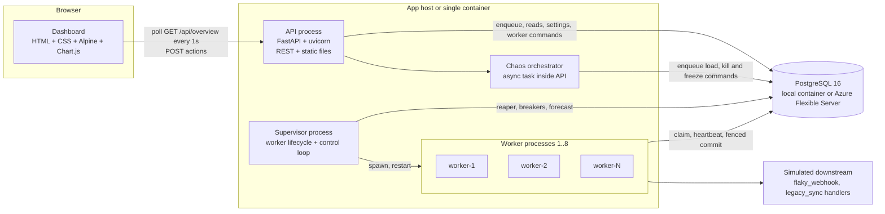
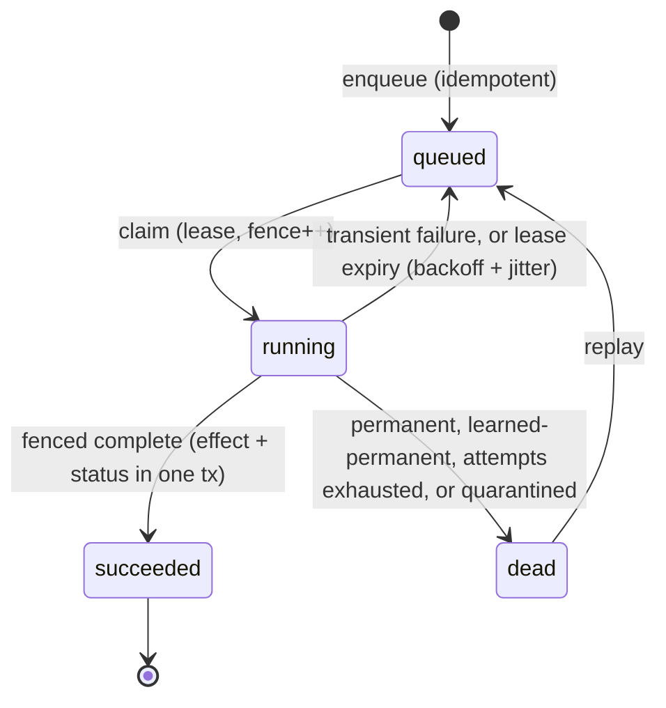
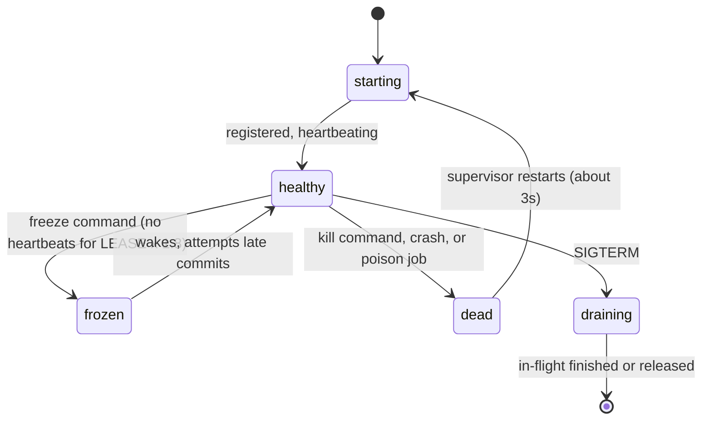
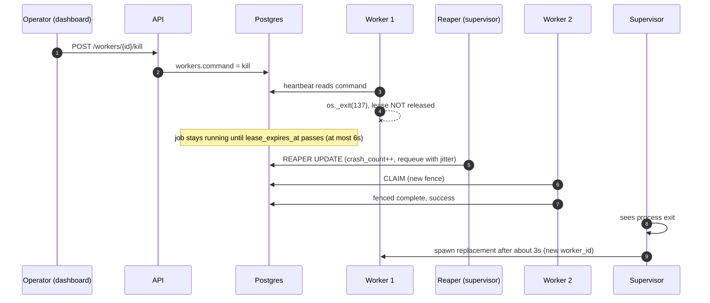
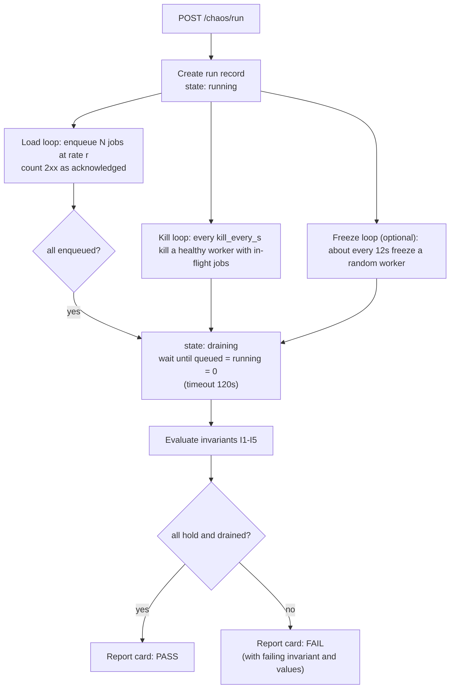
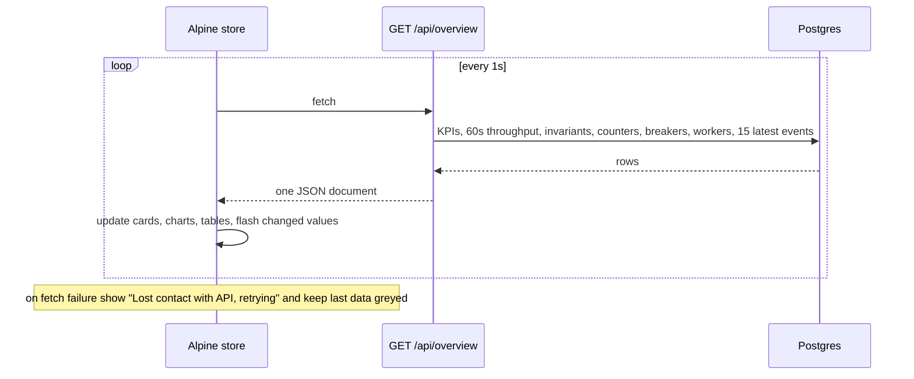
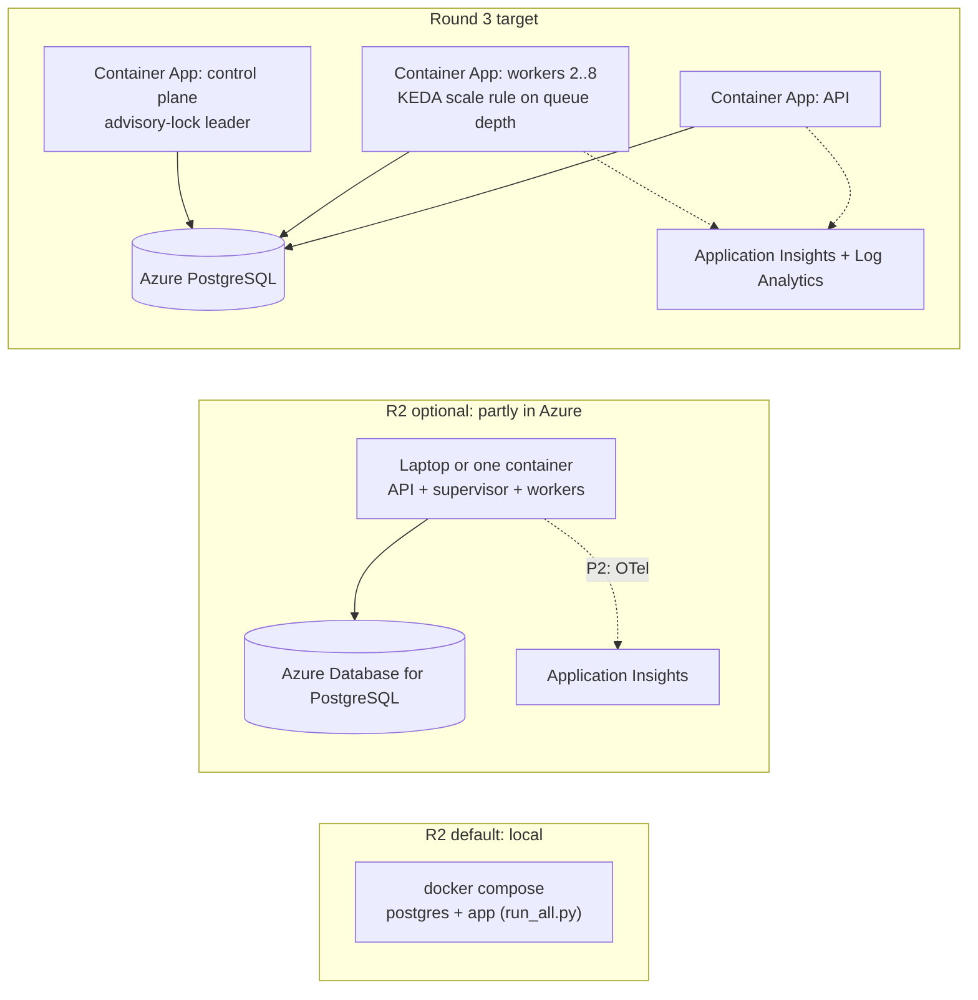

# 02 · Architecture and Workflow: Lazarus Prototype

How the pieces fit and how data and control move through them. All diagrams are Mermaid: paste into mermaid.live or any Markdown viewer that renders it.

---

## 1. Runtime component view



| Component | Owns | Never does |
|---|---|---|
| **API** | Enqueue (idempotent), queries, settings, worker commands, chaos runs, serving the dashboard | Run job handlers |
| **Supervisor** | Worker process lifecycle (desired count), reaper loop, breaker evaluation, forecast | Serve HTTP |
| **Worker** | Claim, heartbeat, run handlers, fenced commit, obey `kill`/`freeze` | Decide retry policy alone (it calls `retry.py`, which reads shared stats) |
| **Postgres** | All durable state, leases, fencing tokens, effects ledger, counters | Anything else. It is the single source of truth |
| **Dashboard** | Rendering, button actions | Hold authoritative state; it re-reads everything each second |

## 2. Job lifecycle



## 3. Worker lifecycle



## 4. Workflows (sequence diagrams)

### 4.1 Enqueue and process (happy path)

```mermaid
sequenceDiagram
  autonumber
  participant P as Producer or Chaos Lab
  participant A as API
  participant D as Postgres
  participant W as Worker
  P->>A: POST /api/jobs {tenant, type, payload, idempotency_key}
  A->>D: INSERT ... ON CONFLICT DO NOTHING RETURNING
  D-->>A: new row, or none for a duplicate
  A->>D: counters.acked++ (new rows only)
  A-->>P: 201 new, or 200 existing
  loop every POLL_INTERVAL while capacity is free
    W->>D: CLAIM (SKIP LOCKED, lease, fence++)
    D-->>W: jobs with fence = f
  end
  par handler runs
    W->>W: run handler
  and lease kept alive
    W->>D: batch heartbeat every 2s
  end
  W->>D: BEGIN; INSERT ledger; UPDATE jobs WHERE fence = f; COMMIT
  D-->>W: rowcount 1 = success, 0 = stale (ROLLBACK)
```

### 4.2 Worker killed mid-job



### 4.3 Frozen worker ("zombie"), fencing ON vs OFF

```mermaid
sequenceDiagram
  autonumber
  participant Z as Worker Z (frozen)
  participant D as Postgres
  participant R as Reaper
  participant W2 as Worker 2
  Z->>D: CLAIM job J (fence = 1)
  Note over Z: freeze command, event loop blocked for LEASE x 1.8, no heartbeats
  R->>D: lease expired, requeue J
  W2->>D: CLAIM J (fence = 2)
  W2->>D: BEGIN; INSERT ledger; UPDATE WHERE fence = 2; COMMIT (ok)
  Z->>Z: wakes, handler returns
  alt Fencing ON (safe)
    Z->>D: BEGIN; INSERT ledger; UPDATE WHERE fence = 1
    D-->>Z: 0 rows, ROLLBACK, stale_writes_rejected++
  else Fencing OFF (unsafe demo)
    Z->>D: BEGIN; INSERT ledger; UPDATE WHERE id = J; COMMIT
    Note over D: two ledger rows for job J, so invariants I2 and I3 turn red
  end
```

### 4.4 Downstream outage and the circuit breaker

```mermaid
sequenceDiagram
  autonumber
  participant U as Operator
  participant D as Postgres
  participant W as Workers
  participant B as Breaker logic
  U->>D: settings.outage_flaky_webhook = true
  W->>D: flaky_webhook attempts fail with HTTP 503
  W->>B: record failure, evaluate window (20s)
  B->>D: samples >= 6 and failure rate >= 70%, so breakers.open_until = now + 15s
  Note over W,D: CLAIM skips job type flaky_webhook while open, held-back gauge rises
  U->>D: outage off
  Note over B: after cooldown jobs flow again as the probe; success keeps it closed, failure re-opens it
```

### 4.5 Chaos run orchestration



### 4.6 Dashboard refresh loop



## 5. `GET /api/overview` contract (build the dashboard against this)

Values are illustrative, not measured.

```json
{
  "ts": "2026-10-18T14:03:11Z",
  "settings": { "fencing_enabled": true, "desired_workers": 3, "outage_flaky_webhook": false, "autoscale": "manual" },
  "kpis": { "total": 512, "processing": 28, "retrying": 12, "dlq": 8, "succeeded": 464 },
  "throughput": [ { "t": "2026-10-18T14:02:12Z", "ok": 9, "failed": 1 } ],
  "invariants": [
    { "id": "I1", "name": "No acknowledged job lost", "ok": true, "value": "512 / 512" },
    { "id": "I2", "name": "No duplicate effects", "ok": true, "value": "0" },
    { "id": "I3", "name": "Exactly-once credits", "ok": true, "value": "0 violations" },
    { "id": "I4", "name": "No ghost effects", "ok": true, "value": "0" },
    { "id": "I5", "name": "No stuck leases", "ok": true, "value": "0" }
  ],
  "counters": { "acked": 512, "stale_writes_rejected": 7, "lease_expired": 12, "quarantined": 1, "retries_avoided": 14, "rate_limited": 0 },
  "breakers": [ { "type": "flaky_webhook", "state": "closed", "open_for_s": 0, "held_back": 0 } ],
  "workers": [ { "worker_id": "worker-1-a3f1", "name": "worker-1", "status": "healthy", "in_flight": 3, "uptime_s": 412, "last_seen_ms": 640, "pid": 4121 } ],
  "events": [ { "at": "2026-10-18T14:03:10Z", "event": "lease_expired", "job_id": "…", "job_type": "ledger_credit", "worker": "worker-2-bb12", "detail": "worker lost" } ]
}
```

`throughput` has 60 entries (one per second). `workers` includes dead rows for 10s after death.

## 6. Deployment views



## 7. Cross-cutting rules

| Concern | Rule |
|---|---|
| Time | Database `now()` only |
| Idempotency | `UNIQUE(tenant_id, idempotency_key)`; duplicate returns the existing job |
| Fencing | Every post-claim write has `fence = $mine`; unsafe mode exists only as a labelled demo toggle |
| Effects | Written in the same transaction as the fenced completion |
| Events | Every transition appends to `job_events` (feeds the feed, throughput chart, breaker window, forecast) |
| Settings | Live in `settings`; workers re-read at most once per second |
| Failure of the API | Workers keep running; the queue is independent of the API |
| Failure of the supervisor | Workers keep running but no reaping. Mention as a known single point (R3: leader election in worker image) |
