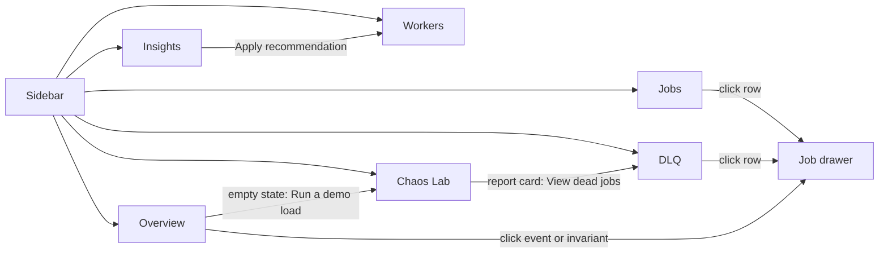
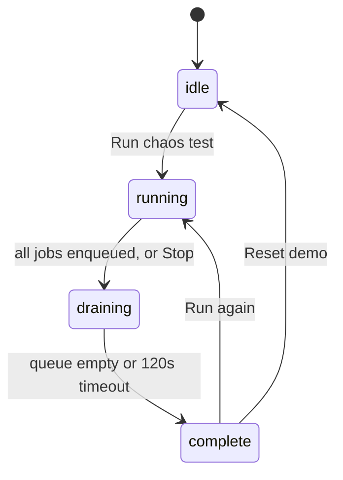

# 04 · Pages and Button Workflow: Lazarus Dashboard

Every page, every button: what it does, which endpoint it calls, and what the user sees. Visual tokens are in `03-ui-ux-palette.md`; API shapes in PRD §7 and `02-architecture-workflow.md` §5.

---

## 1. Navigation map



Tabs switch client-side with no page reload. URL hash mirrors the tab (`#chaos`) so a refresh keeps your place. Keyboard: `1`-`6` switch tabs, `Esc` closes the drawer.

## 2. Global shell (visible on every page)

| Element | Behaviour |
|---|---|
| Sidebar | Logo chip + "Lazarus"; six nav items; active item has a 3px ember bar. Footer: API status dot (`● connected` / `✕ no contact`) and last refresh time |
| Top bar | Left: page title. Right: **Fencing badge** (`FENCING ON` ok / `FENCING OFF` bad), worker count (`3 workers`), **Reset demo** button |
| Connection banner | If 3 consecutive polls fail: warn banner "Lost contact with the API. Retrying every 2s." and the last data is greyed. Clears automatically on success |
| Toasts | Every action confirms in the log-style toast (4s) |

**Reset demo** (Danger): two-step. First click turns the label into "Confirm reset (3s)"; clicking again within 3s calls `POST /api/chaos/reset` (truncates jobs, events, ledger, counters; keeps settings), then toast "Demo reset". No click within 3s reverts the label.

## 3. Pages

### 3.1 Overview

Purpose: the 5-second answer to "is the system healthy and is the proof holding?"

```
┌ TOTAL ──┐ ┌ PROCESSING ┐ ┌ RETRYING ┐ ┌ DLQ ────┐
│  512    │ │  28        │ │  12      │ │  8      │
│ all time│ │ 5% of total│ │ 2%       │ │ 1%      │
└─────────┘ └────────────┘ └──────────┘ └─────────┘
┌ THROUGHPUT, LAST 60 S ───────────────┐ ┌ INVARIANTS ────────────┐
│   ok/s ——   failed/s - - -           │ │ ✓ I1 No ack'd job lost │
│                                      │ │ ✓ I2 No duplicates     │
│                                      │ │ ✓ I3 Exactly-once      │
└──────────────────────────────────────┘ │ ✓ I4 No ghost effects  │
┌ BREAKERS ──────────┐ ┌ COUNTERS ─────┐ │ ✓ I5 No stuck leases   │
│ flaky_webhook ● closed│ stale rejected 7└────────────────────────┘
└────────────────────┘ │ lease expired 12
┌ EVENTS (console) ────┴───────────────────────────────┐
│ 14:03:10 lease_expired  ledger_credit  worker-2-bb12 │
└──────────────────────────────────────────────────────┘
```

| Element | Data | Interaction |
|---|---|---|
| 4 KPI cards | `kpis` | Click Retrying/DLQ → Jobs filtered / DLQ tab |
| Throughput chart | `throughput` | Hover tooltip with exact values |
| Invariants panel | `invariants` | Click a row → short explanation popover ("What this proves") |
| Breaker chips | `breakers` | `● closed` or `✕ open 11s`, with held-back count |
| Counters | `counters` | Informational |
| Events console | `events` | Click a line → opens the job drawer |

Buttons on this page: none destructive. Empty state (total = 0): "No jobs yet." + **Run a demo load** (Primary) → switches to Chaos Lab with defaults prefilled.

### 3.2 Workers

Purpose: the operator view and the Kill/Freeze demo.

| Column | Content |
|---|---|
| Worker | `worker-1` + short incarnation id (`a3f1`) |
| Status | `● healthy` / `▲ frozen` / `✕ dead` / `◐ restarting` |
| In flight | n / concurrency |
| Uptime | mm:ss |
| Last heartbeat | ms ago (turns warn when > 3s) |
| PID | mono |
| Actions | **Kill** (Danger), **Freeze** (Cold), **Logs** (Quiet) |

Page-level: **Scale** stepper (`−` `3` `+`, range 1-8) with caption "Supervisor adds or removes worker processes." and a note when autoscale is `auto`: "Autoscale is on; manual changes are overridden after 10s."

| Button | Action | UI feedback |
|---|---|---|
| **Kill** | `POST /api/workers/{id}/kill` | Toast `kill sent to worker-2-a3f1`. Row → `✕ dead` within ~2s, its in-flight count freezes, a new row `◐ restarting` appears at about 3s. Disabled when the row is already dead/restarting |
| **Freeze** | `POST /api/workers/{id}/freeze` | Toast `freeze sent`. Row → `▲ frozen` for about 11s (heartbeat stops), then `● healthy` |
| **Logs** | opens a drawer filtered to `job_events.worker = id` | Console-style list |
| **− / +** | `POST /api/workers/scale {desired}` | Rows appear or drain; clamps at 1 and 8 with a toast on clamp |

Dead rows remain visible for 10s, then disappear.

### 3.3 Jobs

Filters (secondary controls): status (all, queued, running, succeeded, dead), type, tenant, text search on id. Table columns: id (8 chars), type, tenant, status badge, attempts, priority, age, last error (truncated). Row badges: `QUARANTINED`, `LEARNED-PERMANENT`, `SLOW` (P2).

| Button | Action | Feedback |
|---|---|---|
| **Enqueue job** (Primary, opens a small inline form: tenant, type, JSON payload, idempotency key, delay seconds) | `POST /api/jobs` | 201: toast `queued 3f9a…`; 200: toast `duplicate: returned existing 3f9a…` (this makes idempotency visible); 429: toast `rate limited, retry in Ns` |
| **Refresh** | refetch list | Auto-refresh every 2s, button for manual |
| Row click | `GET /api/jobs/{id}` | Opens the drawer |

**Job drawer:** header (id, type, status badge), key fields (attempts / max, fence, lease owner, crash count, error class, last error, duration), payload and result as mono blocks, and an **event timeline** (every transition with time, worker and detail: enqueued → claimed → lease_expired → claimed → succeeded). Buttons inside: **Replay** (only when dead), **Close**.

### 3.4 DLQ

Dead jobs only. Extra columns: reason (`permanent`, `learned_permanent`, `attempts exhausted`, `quarantined`), attempts, died at.

| Button | Action | Feedback |
|---|---|---|
| **Replay** (row, Secondary with ok text) | `POST /api/jobs/{id}/replay` | Row leaves the list; toast `requeued 3f9a…`; job appears in Jobs as queued |
| **Replay all** (header, Primary) | `POST /api/dlq/replay-all` | Toast `requeued 8 jobs`. Disabled when DLQ is empty |
| Reason filter | client-side | |

Empty state: "DLQ is empty. Nothing has permanently failed."

Note for demo: replaying `validate_order` jobs will fail again (permanent). That is expected and good to narrate; replaying quarantined poison jobs requeues them to crash workers again, so a confirm tooltip reads "This job killed workers 3 times."

### 3.5 Chaos Lab

Purpose: the proof. Layout: left column = run configuration and toggles, right column = live progress and the report card.

**Run configuration (form)**

| Field | Default | Notes |
|---|---|---|
| Jobs | 300 | 50-2,000 |
| Tenants | 3 | |
| Jobs per second | 15 | |
| Kill a worker every | 8 s | 0 = off |
| Freeze workers | on | random freeze about every 12s |
| Noisy tenant | off | P2 (rate-limit demo) |
| Job mix | 50 / 15 / 10 / 10 / 15 | ledger_credit, flaky_webhook, validate_order, legacy_sync, report_export |

**Safety toggles (always visible)**

| Control | Setting | Behaviour |
|---|---|---|
| **Fencing** switch | `fencing_enabled` | Flip applies immediately; the global badge updates. OFF shows the caption "Unsafe. This is the bug fencing prevents." |
| **Simulate downstream outage** (flaky_webhook) | `outage_flaky_webhook` | ON makes every flaky_webhook attempt fail with HTTP 503 |
| **Inject poison job** | `POST /api/chaos/poison {count:1}` | Toast `1 poison job queued`. Workers die up to 3 times, then the job is quarantined |

**Buttons**

| Button | Action | State changes |
|---|---|---|
| **Run chaos test** (Primary) | `POST /api/chaos/run` | Becomes disabled "Running…"; progress card appears |
| **Stop** (Secondary, visible while running) | `POST /api/chaos/run/stop` (add this tiny endpoint) | Ends load and kills; run moves to draining |
| **Run again** | same as Run | Visible after completion |
| **View dead jobs** | switches to DLQ | |

**Run states**



**Progress card** (polls `GET /api/chaos/run/latest` every 1s): bar `enqueued / jobs`, `acknowledged`, `succeeded`, `dead`, `kills sent`, `freezes sent`, elapsed time.

**Report card** (on complete): large **PASS** (ok) or **FAIL** (bad) badge, then a numbers table (acknowledged, succeeded, dead with reason breakdown, lease expiries, stale writes rejected, duplicate effects, retries avoided, quarantined), then I1-I5 with values. On FAIL it names the first failing invariant. PASS rule: all invariants hold and the queue drained.

**Demo flow built into this page:** run (Fencing ON) → PASS → flip Fencing OFF → run again → FAIL (duplicate effects) → flip Fencing ON.

### 3.6 Insights

Three sections, top to bottom.

1. **Retry intelligence** table: job type, error fingerprint, retries observed (n), `p(success on retry)`, verdict (`retry` / `learned-permanent`), retries avoided. A one-line explainer above: "Posterior = (1 + successes) / (2 + successes + failures). Below 0.15 after 8 observations, retries stop." Rows update live.
2. **Breakers**: one card per job type: state, open countdown, opened count, held-back gauge, and an attempts/s chart for `flaky_webhook` with open windows shaded.
3. **Forecast**: chart (actual vs forecast arrival rate), cards `Current workers`, `Recommended workers`, `Why` (λ̂, service time s, backlog), and the controls below.

| Control | Action | Feedback |
|---|---|---|
| **Apply recommendation** (Primary) | `POST /api/workers/scale {desired: recommended}` | Toast `scaled to 5 workers`; disabled when recommended equals current |
| **Autoscale** switch (manual / auto) | `POST /api/settings {autoscale}` | In auto mode a caption shows the 10s cooldown and the last applied change |

## 4. Cross-page button rules

| Rule | Detail |
|---|---|
| Destructive demo actions (Kill, Freeze, Poison) | No confirm dialog: they are the demo |
| Data-destroying action (Reset demo) | Two-step confirm |
| Optimistic UI | Only for toasts; state changes always come from the next poll (no fake state) |
| Double-click protection | Buttons disable while their request is in flight |
| Errors | Non-2xx → toast `error: <message>` in `--bad` background, button re-enabled. Network error → connection banner |
| Idempotent endpoints | Safe to retry (Kill on a dead worker returns 409 and toast `worker already dead`) |

## 5. Empty, loading and error states

| Screen | Empty | Loading (first fetch) | Error |
|---|---|---|---|
| Overview | KPI zeros + "No jobs yet. Run a demo load." | Skeleton = hairline boxes, no shimmer | Connection banner, last data greyed |
| Workers | "No workers. Supervisor not running? Check run_all.py." | rows as `—` | same |
| Jobs / DLQ | "No jobs match." / "DLQ is empty." | `—` | toast |
| Chaos Lab | "No runs yet." | disabled form | toast + form re-enabled |
| Insights | "Not enough data yet (need 8 retries)." | `—` | toast |

## 6. Button inventory (for the QA pass)

| # | Button | Page | Endpoint | Priority |
|---|---|---|---|---|
| 1 | Kill | Workers | `POST /workers/{id}/kill` | P0 |
| 2 | Freeze | Workers | `POST /workers/{id}/freeze` | P0 |
| 3 | Scale − / + | Workers | `POST /workers/scale` | P0 |
| 4 | Logs | Workers | `GET /events?worker=` | P1 |
| 5 | Enqueue job | Jobs | `POST /jobs` | P0 |
| 6 | Row → drawer | Jobs, DLQ, Overview | `GET /jobs/{id}` | P0 |
| 7 | Replay | DLQ, drawer | `POST /jobs/{id}/replay` | P0 |
| 8 | Replay all | DLQ | `POST /dlq/replay-all` | P0 |
| 9 | Run chaos test | Chaos Lab | `POST /chaos/run` | P1 |
| 10 | Stop | Chaos Lab | `POST /chaos/run/stop` | P1 |
| 11 | Fencing switch | Chaos Lab | `POST /settings` | P0 |
| 12 | Outage switch | Chaos Lab | `POST /settings` | P1 |
| 13 | Inject poison job | Chaos Lab | `POST /chaos/poison` | P0 |
| 14 | Apply recommendation | Insights | `POST /workers/scale` | P1 |
| 15 | Autoscale switch | Insights | `POST /settings` | P2 |
| 16 | Reset demo | Global | `POST /chaos/reset` | P0 |
| 17 | Run a demo load | Overview empty state | navigates to Chaos Lab | P0 |

Note: item 10 (`/chaos/run/stop`) is a small addition to PRD §7; add it to the API list when building.
