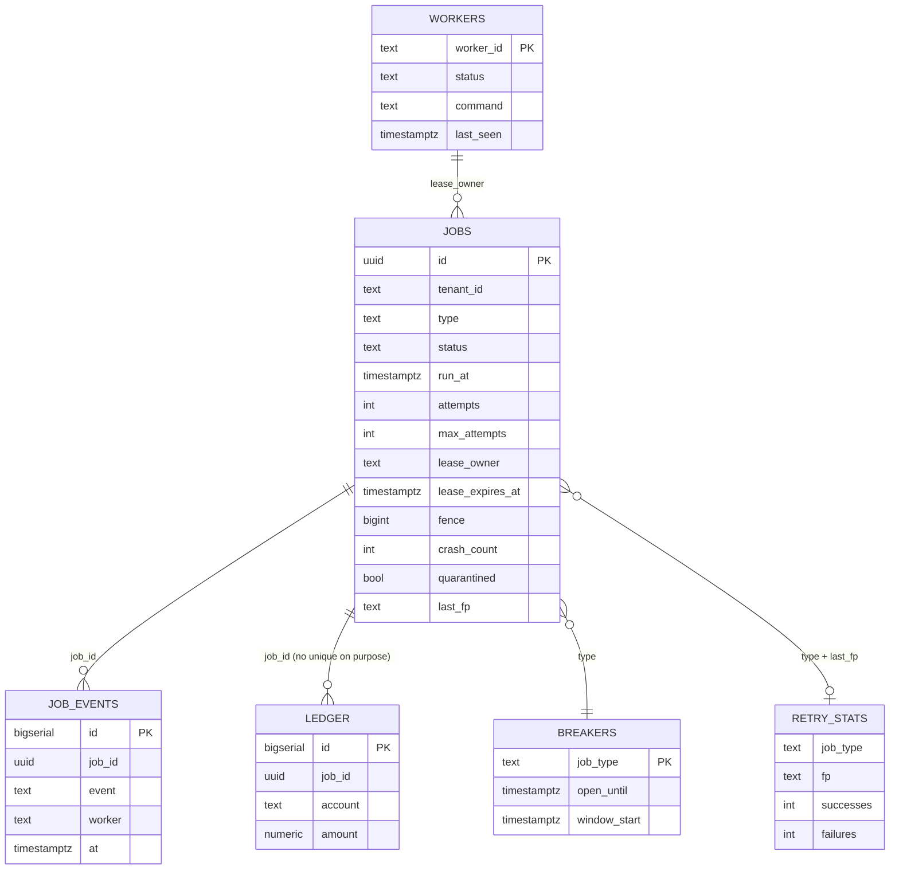

# 05 · System Design: Lazarus

Staff-level design doc for the reliable asynchronous job runner. The prototype implements the reliability core for real; scaling topology is simulated and marked as such.

Numbers marked **[target]** are design targets for the demo, not measurements. Numbers marked **[measure]** must be filled from your own runs before you quote them.

---

## 1. Problem and scope

Asynchronous job runners fail in six predictable ways: lost jobs on worker crash, double execution after timeout, retry storms, poison jobs, noisy neighbours, and no evidence that nothing was lost. The system must make delivery guarantees explicit and **testable under failure**.

**In scope (R2 prototype):** idempotent submission, leased at-least-once execution, fenced effectively-once effects, bounded retries with jitter, DLQ and replay, poison quarantine, circuit breaker, learned retry classification, load forecast and worker recommendation, live proof (invariants + chaos).
**Out of scope (R3):** KEDA/multi-replica topology, leader election, fair claiming, authentication and tenant isolation, SSE, Service Bus adapter, multi-queue routing, cron.

## 2. Requirements

### Functional
1. Submit a job (tenant, type, payload, optional idempotency key, priority, delay).
2. Execute it on a pool of workers; report success or failure.
3. Retry transient failures with backoff and jitter; dead-letter permanent ones; replay from DLQ.
4. Survive worker death, worker freezes and downstream outages without losing or double-applying effects.
5. Expose live state and correctness proofs through a dashboard.

### Non-functional (targets for the demo environment)

| Property | Target | How verified |
|---|---|---|
| Durability | No acknowledged job lost | Invariant I1 + chaos report |
| Effect integrity | 0 duplicate ledger effects with fencing ON | Invariants I2/I3/I4 |
| Recovery time after worker kill | ≤ lease + reaper interval + claim ≈ **~10 s** [target] | Measure per kill in chaos runs: [measure] |
| Dashboard freshness | ≤ 1-2 s | Poll interval |
| Scale of the demo | 300-2,000 jobs, 3 tenants, 2-8 workers [target] | Chaos Lab |
| Throughput | Report only what you measure: [measure] jobs/s at 3 workers | Chaos run timing |
| Cold start to demo | `docker compose up` ≤ 2 min [target] | Rehearsal |

## 3. High-level design

See `02-architecture-workflow.md` for the diagrams. Summary:

- **API** accepts jobs and commits them to PostgreSQL before acknowledging.
- **Workers** pull: claim a batch with `FOR UPDATE SKIP LOCKED`, take a lease and a fencing token, run handlers concurrently, extend the lease with one batch heartbeat, and commit the effect and the completion in **one transaction guarded by the fence**.
- **Supervisor** runs the reaper (reclaims expired leases), evaluates circuit breakers, computes the forecast, and keeps the desired number of worker processes alive.
- **Dashboard** polls one overview endpoint; chaos and toggles are API actions.

## 4. Key design decisions (ADR style)

| # | Decision | Alternatives | Why this | Cost |
|---|---|---|---|---|
| D1 | **Postgres is queue and source of truth** | Service Bus, Redis, RabbitMQ | Effect + completion must be one atomic commit; DLQ, replay, fairness and invariants are plain SQL | Throughput ceiling of one DB; mitigated by batching and measured honestly |
| D2 | **Pull-based workers with leases** | Push from broker | Natural backpressure; stateless workers; crash = lease expiry | Poll latency (≈ 0.3 s) |
| D3 | **Fencing token (`fence++` on claim; every write `WHERE fence = $mine`)** | Leases alone | Leases cannot stop a paused worker that wakes later; fencing makes stale writes impossible | One extra column and predicate |
| D4 | **Database clock for all deadlines** | NTP-synced app clocks | One time source, no skew bugs | Needs a DB round trip for time-based decisions |
| D5 | **At-least-once delivery + transactional effects = effectively-once** | "Exactly-once delivery" | Exactly-once delivery is not achievable across failures; idempotent/transactional effects are | External side effects are only exactly-once if the downstream honours the forwarded idempotency key (stated openly) |
| D6 | **Reaper reclaims by lease expiry, not by crash detection** | Worker liveness pings | Works for kill, freeze and partition uniformly | Recovery bounded below by lease length (6 s in demo) |
| D7 | **Quarantine by repeated lease expiry** | Only exception counting | A poison job that kills the process never reports an error | Might mislabel jobs killed repeatedly by chance; threshold 3 plus infrequent chaos kills keeps this unlikely |
| D8 | **Stats-based learning (Beta posterior)** | Trained ML model | Explainable, tiny, needs no training data | Not a general classifier |
| D9 | **Polling dashboard** | SSE/WebSocket | Fewer moving parts | 1 s granularity |
| D10 | **Supervisor-managed subprocesses in R2** | Containers per worker | Real process death, one-command run | Not real orchestration; R3 uses Container Apps replicas |

## 5. Data model



Full DDL and all queue SQL: **PRD §6 (verbatim contract)**. Design points:

- `UNIQUE (tenant_id, idempotency_key)` gives idempotent submission.
- Partial indexes keep the claim and reaper scans small: `jobs_claim_idx … WHERE status='queued'`, `jobs_lease_idx … WHERE status='running'`.
- `ledger` intentionally has **no uniqueness on job_id**: the proof of exactly-once is that the application never inserts a second row, not that a constraint hides the bug.
- `settings` and `counters` are small key-value tables shared across processes.

## 6. Core algorithms

### 6.1 Claim, lease, fence
Claim a batch (`LIMIT capacity`) with `SKIP LOCKED`, set `status=running`, `lease_expires_at = now()+LEASE`, `attempts++`, `fence++`, skipping job types whose breaker is open. Contending workers never block each other.

### 6.2 Heartbeat
One `UPDATE … WHERE lease_owner=$w AND status='running' RETURNING id, fence` per worker per 2 s extends all of its leases. The worker compares the returned `(id, fence)` pairs with its in-flight set; any in-flight job missing from the result lost its lease, and its handler task is cancelled. The same beat reads the worker's command channel (`kill`, `freeze`).

### 6.3 Fenced commit
```
BEGIN
  INSERT INTO ledger (...)                 -- effect
  UPDATE jobs SET status='succeeded' WHERE id=$1 AND fence=$2 AND status='running'
  rowcount = 1 → COMMIT
  rowcount = 0 → ROLLBACK (effect discarded), count stale write
```

### 6.4 Retry and backoff
`delay = uniform(0, min(cap, base · 2^attempt))` (full jitter; base 1.5 s, cap 20 s in the demo). After `max_attempts` (5) the job is dead-lettered. Full jitter decorrelates retries so they do not arrive in waves.

### 6.5 Reaper
Every 2 s: select expired running jobs (`SKIP LOCKED`, up to 100), set `crash_count++`, requeue with jittered backoff, or mark dead + quarantined at `crash_count ≥ 3`.

### 6.6 Circuit breaker (per job type)
Window: attempts after `window_start` and within 20 s. Open when samples ≥ 6 and failure rate ≥ 70% → `open_until = now+15 s`. Claims skip open types. After cooldown, jobs flow as a probe; failures re-open. Prevents hammering a failing dependency and prevents retries from exhausting `max_attempts` during an outage.

### 6.7 Learned retry classification
Fingerprint `ExceptionClass:code`. Rules first (validation and most 4xx are permanent). Then for each `(type, fp)` track whether a retry later succeeds: posterior `p = (1+s)/(2+s+f)`. At `n ≥ 8` and `p < 0.15` the job is dead-lettered early. Learning is suspended while the type's breaker is open or cooling, because an outage is systemic rather than job-specific failure.

### 6.8 Forecast and recommendation
Arrival rate from 5 s buckets over 120 s, Holt linear smoothing (α=0.4, β=0.2) for the next bucket (λ̂), service time `s` from recent successes, concurrency `c` per worker:
`recommended = clamp(ceil((λ̂·s + backlog·s/30) / c × 1.2), 1, 8)`.
This is Little's law plus a drain-the-backlog term with 20% headroom. In R3 the same metric drives a KEDA scale rule.

## 7. Consistency and failure analysis

| Failure | Detection | Recovery | Guarantee preserved |
|---|---|---|---|
| Worker `kill -9` mid-job | Lease expiry | Reaper requeues; another worker runs it | At-least-once; no loss |
| Worker freezes, wakes late | Fence mismatch on its commit | Stale write rejected and rolled back | No duplicate effect |
| Transient handler error | Exception / classifier | Requeue with jittered backoff | Bounded retries |
| Permanent error | Rule or learned verdict | DLQ immediately | No wasted retries |
| Poison job (kills worker) | Repeated lease expiry | Quarantine at 3 | Fleet not crash-looped indefinitely |
| Duplicate submission | Unique key conflict | Return existing job | Idempotent submission |
| Downstream outage | Failure rate in window | Breaker opens, claims paused | No retry storm; attempts preserved |
| API crashes mid-enqueue | Transaction not committed → client gets error/timeout | Client retries with the same idempotency key | No lost acknowledged job, no duplicate |
| API crashes after commit, before ack | Client sees timeout | Retry with same key returns existing job | Idempotent |
| Supervisor dies | Workers keep running, no reaping | Restart supervisor; reaper catches up | No data loss; recovery delayed (R3: leader election inside worker image) |
| Postgres restarts | Connection errors | Workers/API reconnect with backoff; leases and state are durable | Durability = Postgres durability |
| Postgres unavailable | Health check | Everything stalls, nothing is lost | Safe, not live |
| Clock skew between processes | n/a | Not applicable: only DB `now()` used | |
| Handler hangs but heartbeats continue | **Not detected** in R2 | R3: per-type max runtime that cancels and fails the attempt | Documented limitation |

Delivery semantics statement for the slide: *at-least-once delivery; effects are applied once per job inside our database via fenced transactions; effects on external systems are applied once only if the downstream honours the forwarded idempotency key.*

## 8. Concurrency and capacity

- **Connection budget:** API 10 + supervisor 3 + up to 8 workers × 3 = 37 of Postgres' default 100.
- **In-flight capacity:** workers × concurrency (3 × 4 = 12 by default).
- **Claim contention:** `SKIP LOCKED` removes lock waits; the claim query uses the partial index; batch claim amortizes round trips.
- **Per-job DB cost** (design view): ~1 insert (enqueue), 1 claim update, ~1/N heartbeat share, 1 transaction for ledger + completion, 1-3 event inserts. Event inserts are the largest write amplification; they are indexed by `at` and `job_id` only.
- **Bottleneck expectation:** the single Postgres, then event inserts. Do not quote throughput numbers; run a load and write down the measured jobs/s: **[measure]**.
- **Dashboard load:** 1 overview fetch per second per open tab = a handful of aggregate queries; indexed, bounded to 60 s windows.

## 9. Scaling path (Round 3)

| Step | Change |
|---|---|
| 1 | Workers become Container Apps replicas (2-8), KEDA scale rule on queued-ready count |
| 2 | Reaper/control loop moves into the worker image with `pg_try_advisory_lock` leader election |
| 3 | Fair claiming across tenants (per-tenant running caps / round-robin ordering in the claim query) |
| 4 | Partition hot tables if needed (events by time), archive finished jobs |
| 5 | Optional Service Bus adapter for ingestion from external producers (the DB remains authoritative) |
| 6 | Per-type handler timeouts, cron schedules, multi-queue routing |
| 7 | Auth and tenant isolation, secrets in Key Vault, private networking to Postgres |

## 10. Observability design

| Signal | Source | Where seen |
|---|---|---|
| Transitions | `job_events` | Events console, job drawer timeline |
| Throughput, failure rate | `job_events` grouped by second | Overview chart, breaker window |
| Counters | `counters` | Overview counters |
| Invariants | SQL checks every second | Invariants panel, report card |
| Worker health | `workers` | Workers page |
| Traces (P2) | OpenTelemetry spans per job lifecycle (`enqueue`, `claim`, `handle`, `commit`) | Application Insights |

## 11. Security notes (honest)

Prototype has no authentication, no tenant isolation beyond the `tenant_id` column, and a destructive `reset` endpoint. It is a demo system; do not expose it publicly. R3: authN/Z, per-tenant isolation, TLS everywhere, secrets in Key Vault, restricted DB network access.

## 12. Testing strategy

| Level | What | Tool |
|---|---|---|
| Unit | Backoff bounds, fingerprinting, posterior math, Holt forecast, recommendation clamp | pytest |
| Integration (real Postgres) | Concurrent claim, fencing, reaper, idempotency, replay, quarantine | pytest-asyncio |
| System | Chaos Lab PASS ×3; Fencing OFF → FAIL | Dashboard |
| Property (stretch) | Random schedules of kill/freeze never violate I1-I5 | Chaos runs with different seeds |

## 13. Open risks

1. Hung handlers keep leases alive (no per-job timeout yet).
2. Single control loop is a single point of delay.
3. Quarantine may mislabel a job that was unlucky; surfaced via the threshold and the drawer timeline.
4. Learned-permanent could misfire during a partial outage; mitigated by the breaker guard, to be tuned in R3.
5. Throughput is bounded by one Postgres; measured and reported, not claimed.
